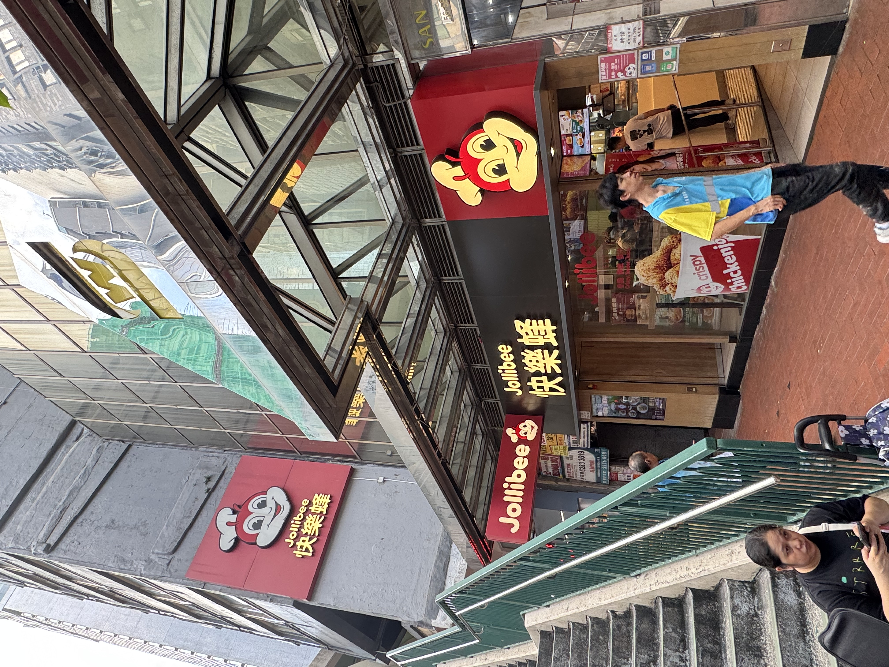
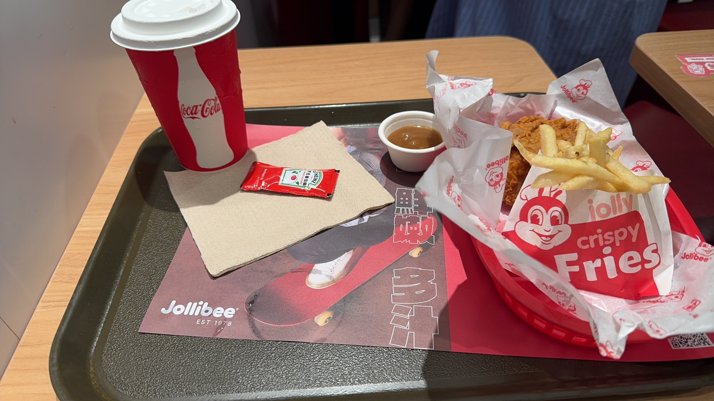
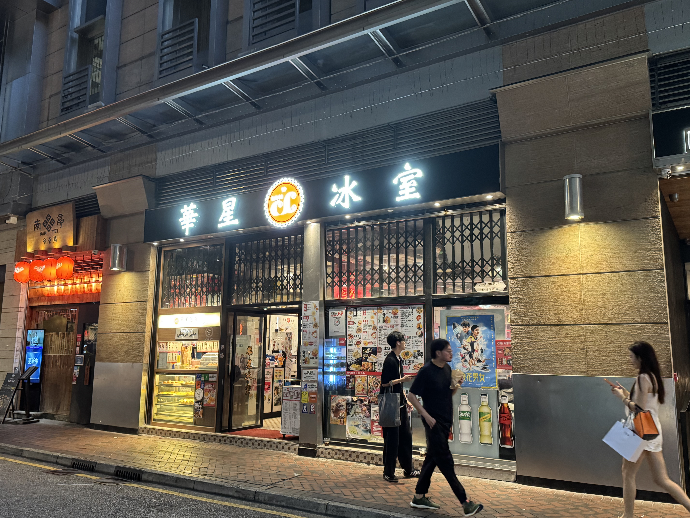
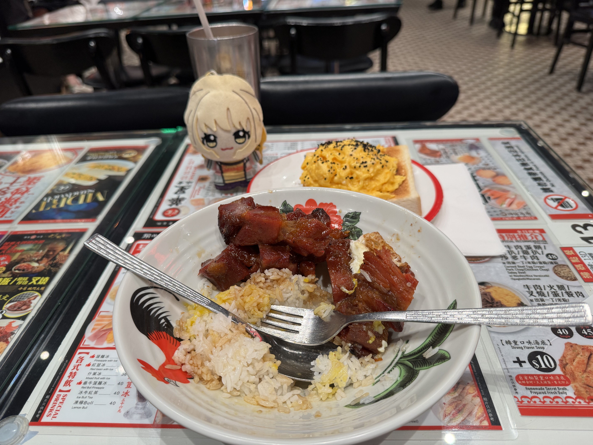
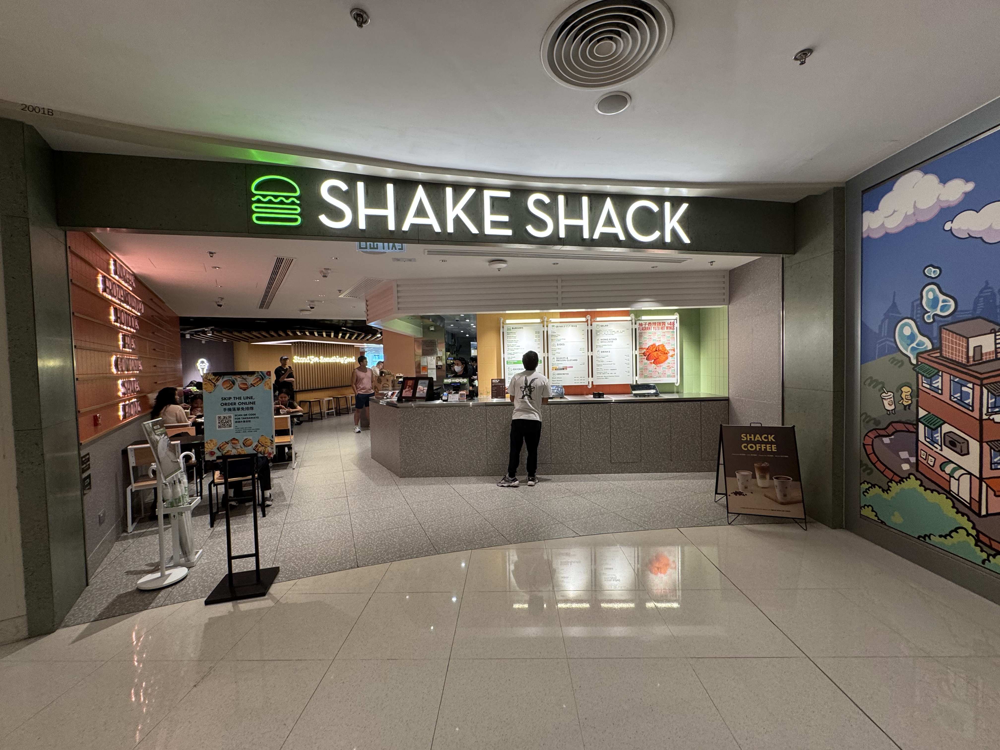
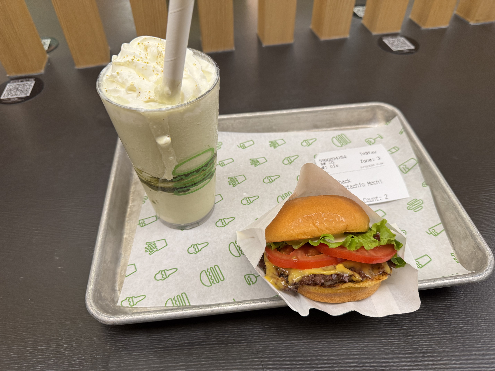
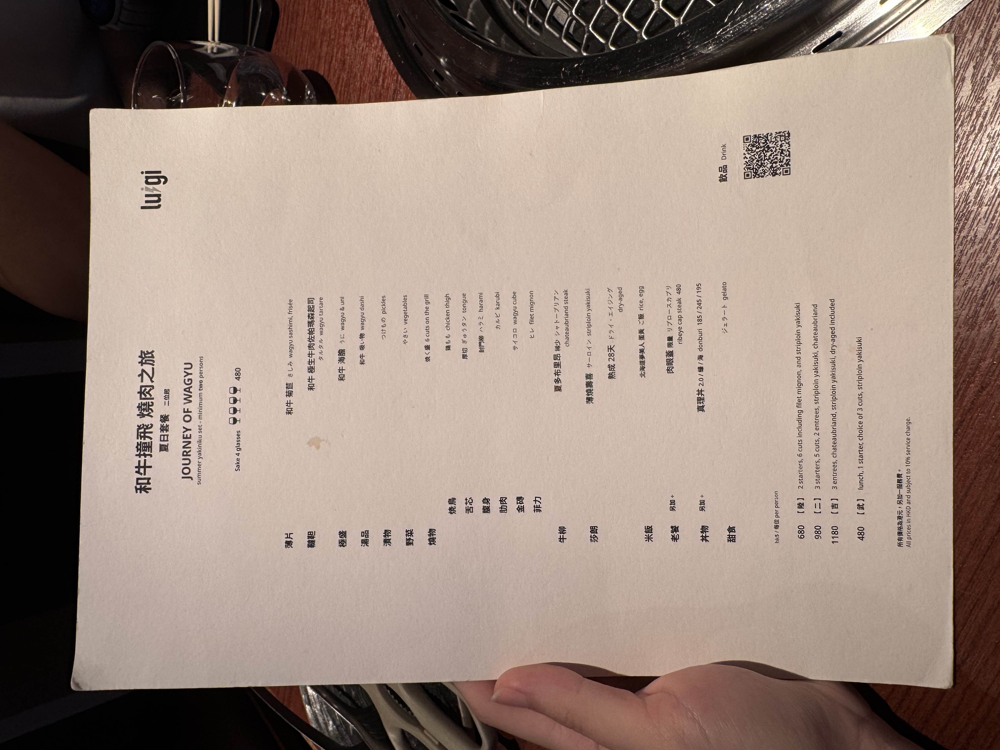
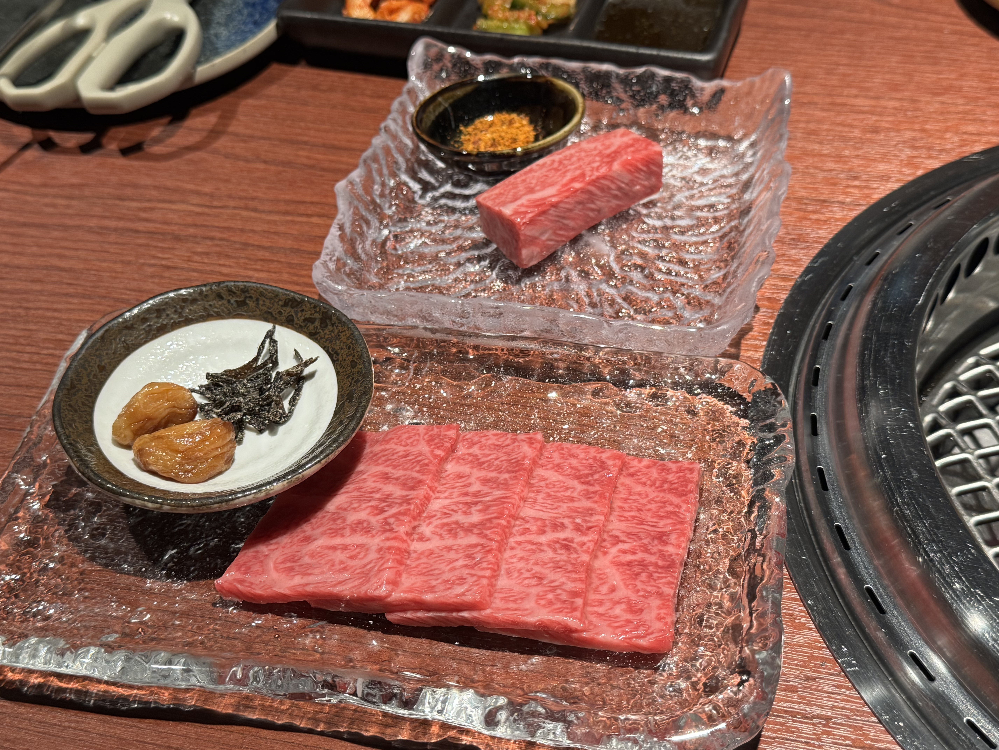

## 香港吃吃喝喝记录

这次在香港随手记录了几家吃过的店。

### 1. Jollibee 快乐蜂炸鸡

第一站是香港的 **Jollibee 快乐蜂**。肉汁确实是精髓，这东西比较好吃。

### 2. 陈奕迅推荐的华星冰室

接下来去尝试了陈奕迅推荐过的 **华星冰室**。Eason推荐这家店的黑龙城寨叉烧可以，其它确实不太符合内地口味。

### 3. Shake Shack

Shake Shack 的汉堡和饮品味道不错，不过价格确实相对更贵一些。如果只是想吃汉堡，性价比不算特别突出。

### 4. Lugi 烧肉与 SOMA 台湾奶茶

最后是 **Lugi 烧肉**，这次吃的是 A5 和牛烧肉。菜单上的和牛套餐内容比较丰富，从刺身、前菜到烧肉都有，整体更适合安排一顿正式一点的晚餐。A5 和牛的纹理非常漂亮，入口也确实比较嫩，但价格自然不便宜。

另外还喝到了 **SOMA 台湾奶茶**，可以作为烧肉之后的饮品补充。整体来说，这一餐属于体验感不错、但需要考虑预算的一顿。

