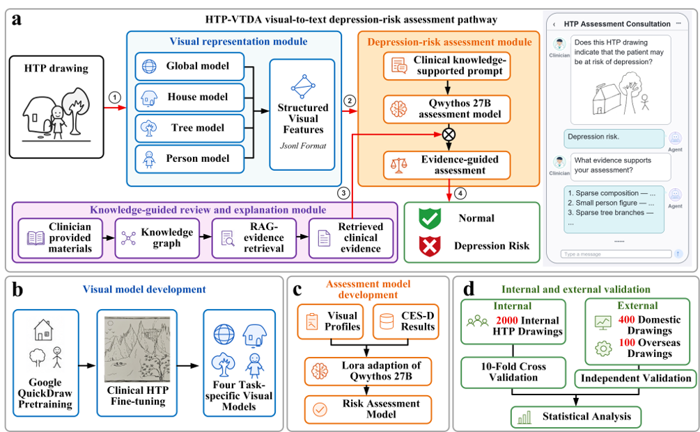

这是我的 **医学 AI Agent 开发日志**系列目录。该技术框架将为医工交叉领域想使用AI Agent作为开发主体的人提供思路。

本系列以房–树–人（House–Tree–Person，HTP）绘画的抑郁风险评估为实例展开。本篇先介绍项目目的、总体技术路线与重点创新设计；后续文章按第二部分的目录逐步更新，代码、实验设置与结果会放到对应篇章中说明。

## 一、项目目的

房树人测试（House–Tree–Person，HTP）是一种投射性心理评估方法，通过让受试者绘制房屋、树木和人物，结合绘画特征、访谈及其他评估信息，辅助了解其情绪状态与心理特点。本研究的核心是将绘画特征提取、知识检索和风险评估等工作交由医学 AI Agent 协同完成，生成可追溯依据的评估报告，提供可靠、便利的临床决策支持。

我采用的框架称为 **HTP-VTDA（House–Tree–Person Visual-to-Text Depression Assessment）**。它将绘画分析拆分为视觉特征提取与文本评估两个主要环节，再加入知识检索、规则校准和解释生成，逐步构建一个能够协调这些工具的医学 AI Agent。

项目主要围绕以下目标展开：

- **建立可复核的视觉描述。** 分别整理整体、房屋、树木和人物特征，让后续判断建立在明确的观察记录上。
- **实现知识支持的风险评估。** 将结构化视觉特征与医学知识结合，输出风险判断及相关证据。
- **保留完整的评估依据。** 区分图像中观察到的内容、检索得到的知识和模型推断，方便检查错误发生在哪个环节。
- **检验不同数据来源下的表现。** 同时关注内部验证和独立测试，分析模型面对不同绘画风格、采集条件时的稳定性。

## 二、当前技术思路与后续更新目录

### 总体技术路线

整个流程从一张 HTP 绘画开始，先提取**整体、房屋、树木、人物**四类视觉特征，再将这些信息整理为字段统一的 JSON 或结构化文本。评估模块读取这份视觉描述，结合医学知识完成风险判断；知识检索模块提供相关证据，用于支持评估、复核与解释报告生成。

主流程可以概括为：

**HTP 绘画 → 四类视觉特征 → 结构化文本 → 风险评估与知识检索（内含SHAP） → 规则校准和复核 → 评估结果与证据解释。**

参考当前阶段报告，视觉特征提取使用 Qwen3-VL 30B，文本评估使用 Qwythos 27B。模型名称对应当前实现版本，后续如果更换基底模型，会在日志中说明原因及对照结果。LightRAG 知识图谱的构建过程会单独展开，其具体贡献需要通过实验验证。

图中的训练流程与推理流程需要区分：模型开发阶段涉及数据划分、迁移学习和微调；面对新绘画时，则调用已经训练好的模型及知识库完成评估。后续推文按以下顺序更新。

### 1. 基础环境搭建

这一部分介绍 Python、PyTorch、CUDA 与 GPU 环境配置，以及 Docker 部署工具的安装与配置，先把模型运行和训练所需的基础环境搭建起来。

堡垒机和服务器使用指导作为可选内容，介绍如何连接远程服务器、传输数据并使用 A100 GPU 运行任务。如果选择在本地 RTX 4090 上运行，可以跳过远程服务器部分；具体可运行的模型和训练配置，需要结合显存、量化方式及微调方案确定。

### 2. 数据整理以及预处理

这一部分先介绍数据来源、数据量及各部分数据的用途，包括用于前期训练的开源简笔画数据，以及后续使用的临床房树人绘画数据。

重点说明图片与文本数据如何一一配对：通过统一的样本编号，将绘画、对应的视觉特征描述和评估标签关联起来，检查缺失或错配记录，再按照模型要求转换为可训练的图文样本与文本样本格式。同时说明训练集、验证集和测试集的划分方式，避免同一受试者的数据出现在不同集合中。

### 3. 视觉特征提取模型的开发

视觉模块基于 **Qwen3-VL-30B**，分别开发**整体、树木、房屋、人物**四大元素各自的特征提取模型，将绘画中的信息转化为结构化特征文本，供后续评估模型使用。

#### 3.1 迁移学习模型开发

房树人任务需要识别的部分元素较为抽象，特征描述也带有一定主观性，因此先从相对基础的简笔画识别入手。我从 Google QuickDraw 数据集中选取了房屋、树木和人物相关的开源简笔画数据，分别训练这三类元素的第一阶段基底模型，为后续临床数据微调建立基础。

整体元素涉及画面的整体氛围与布局描述，目前没有找到适合本任务、可直接用于这一阶段训练的开源标注数据，因此整体模型不沿用这三类局部元素的 QuickDraw 训练路径。这一期会说明数据选择、训练样本构建和第一阶段模型开发过程。

#### 3.2 最终视觉特征提取模型开发

这一阶段进行二次微调，将前期训练得到的房屋、树木和人物基底模型迁移到临床房树人绘画数据上，开始学习与实际评估任务相关的绘画特征。整体模型则基于 Qwen3-VL-30B，使用临床数据中的整体描述进行任务微调。

本部分介绍临床图文样本的组织、微调配置和输出规范，最终形成整体、树木、房屋、人物四类特征提取模型，并将它们的输出整理为统一的结构化文本。

### 4. 评估模型的开发

将全部绘画的特征文本与对应标签组成文本对：输入是四类视觉特征的组合，目标输出是“正常”或“抑郁”标签。基于 **Qwythos 27B** 训练评估模型，使其学习什么样的特征组合对应不同类别，再逐步加入知识图谱、规则库和解释流程。这里的类别名称沿用数据集标签，模型输出用于风险评估。

#### 4.1 二分类评估模型开发

首先完成二分类评估模型开发，介绍特征文本与标签的训练格式、Qwythos 27B 的微调方式，以及预测标签的输出和评估方法。该模型负责给出初步分类结果，也是后续完整智能评估流程的基础。

#### 4.2 LightRAG 知识图谱制作

采用 **LightRAG** 算法，将医生提供的医学知识文本整理为知识图谱。本部分介绍资料清洗、文本切分、实体与关系抽取，以及图谱构建和检索方法，保留知识来源，使后续评估可以检索与绘画特征相关的医学依据。

#### 4.3 完全体智能评估模型开发

完整模型由 Agent 串联以下步骤：

1. **初步评估：** 评估模型读取绘画特征文本，给出初步分类标签。
2. **特征贡献分析：** 使用 SHAP 分析各特征对初步预测的贡献，并给出贡献度排序。
3. **知识与规则融合：** 将初步标签、特征文本及贡献度信息，与 RAG 检索到的医学知识和额外规则库结合起来，进行综合判断。
4. **最终结果与解释：** 输出最终标签、支持该标签的具体特征，以及这些特征对应的临床解释，并保留相关知识来源和规则依据。

SHAP 用于解释模型预测中的特征贡献，RAG 与规则库用于提供知识支持和复核依据。如果综合判断改变了初步标签，也需要记录改变的原因，区分初步预测的归因与最终结论的证据。

### 5. 各类模型的内外部验证手段

- **视觉特征验证：** 与人工标注比较，检查字段一致性、遗漏和错误描述。
- **内部验证：** 使用十折交叉验证评估不同数据划分下的稳定性，严格分离训练、调参与测试。
- **独立测试：** 检查国内预留数据和海外数据上的表现，并按来源分别分析。
- **模块消融：** 比较有无知识检索、有无规则校准及不同视觉特征组合，评估模块贡献。
- **模型对照：** 在相同数据划分与评估条件下比较文本编码器、不同基底大模型和完整框架。
- **统计分析：** 报告置信区间，介绍配对 bootstrap、McNemar 检验和 Holm 多重比较校正。
- **解释质量：** 检查解释与图像观察是否一致、引用是否准确，以及是否出现没有证据支持的推断。

阶段报告记录了 2000 例内部开发及十折验证数据，以及由 400 例国内预留数据与 100 例海外数据组成的 500 例混合来源测试数据。当前报告中的内部 Accuracy 为 83.5%，混合来源测试 Accuracy 为 72.0%。这两个结果对应各自的实验设置，不能直接推广到其他人群；完整指标与统计比较会在验证篇展开。

**更新说明：** 本篇作为系列总入口维护。后续文章按照以上顺序更新，3.1、3.2、4.1、4.2、4.3 可根据内容继续拆分为多期；发布后在这里补充文章链接。每篇沿用正文顶部的系列扉页图，本次先完成目录篇。

## 三、重点创新设计

### 1. 提出可替换基底模型的评估框架

本研究提出 HTP-VTDA 评估框架，将视觉特征提取、结构化文本构建、风险评估、特征归因、知识检索和规则复核组织为完整流程。核心贡献在于这套评估框架及模块之间的协作方式。

当前使用 Qwen3-VL-30B 和 Qwythos 27B，后续可以替换为其他适合任务的视觉语言模型或 LLM。在保持输入输出约定和评估流程一致的前提下，各模块能够独立升级，并通过相同的验证方案比较替换后的效果。

### 2. 通过 SHAP 与 RAG 知识图谱建立清晰的证据链

SHAP 提供特征对初步预测的贡献度排序，RAG 知识图谱提供与这些特征相关的医学知识，额外规则库参与综合判断与复核。最终报告需要说明：**观察到了什么特征、这些特征如何影响模型预测、检索到了哪些医学依据，以及为什么形成最终标签。**

这套设计旨在使每个推论都能追溯到对应的观察、知识或规则依据。特征贡献解释与临床因果解释需要区分，证据链的准确性和完整性也将纳入后续验证。

### 3. 面向临床应用的轻量部署与低成本维护

临床应用是框架的重要落地方向。通过模块化设计，可以分别更新知识图谱、规则库或模型，减少每次调整都重新训练整个系统的成本，并支持快速调用和持续维护。

后续计划通过模型蒸馏与必要的压缩，将大型模型的任务能力迁移到更轻量的模型，目标是在符合硬件要求的医院电脑上直接部署和调用。具体能够达到的推理速度、资源占用与评估性能，需要在蒸馏后进行实测，以确认轻量化后的模型仍满足任务要求。

---

*医学 AI Agent 开发日志持续更新，记录从环境搭建到模型验证的完整过程。*
