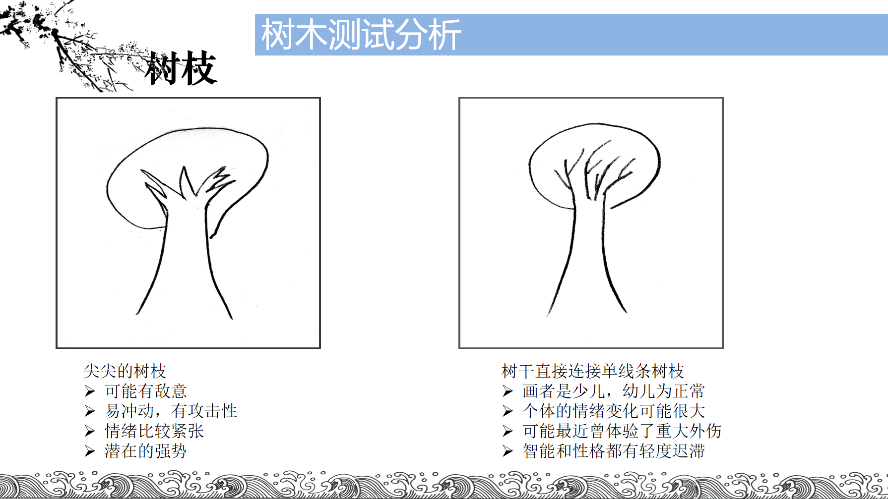
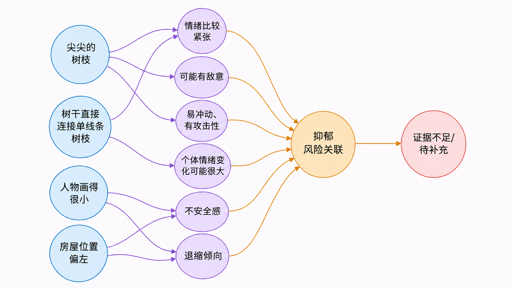

## 一、先看整体逻辑：模型为什么需要 SHAP 和 RAG？

HTP-VTDA 的初步分类模型会根据结构化视觉特征，给出“正常”或“抑郁”的研究分类。但仅有一个分类结果，还无法回答两个问题：

1. **模型为什么会给出这个结果？** 哪些绘画特征对初步分类影响较大？
2. **这些绘画特征在临床上应该如何理解？** 它们对应哪些心理学解释，这些解释是否与抑郁风险有关，有没有专业资料支持？

因此，后续增加两个相互衔接、但职责不同的模块：

- **SHAP：解释模型的初步判断。** 找出哪些结构化视觉特征推动或削弱了模型对某一类别的判断。
- **RAG：补充外部临床知识。** 根据实际观察到的绘画特征，检索医生培训资料、专业文献等知识，再由 LLM 结合初判、SHAP 和检索证据进行复核。

整体链路可以概括为：

```text
结构化视觉特征
      ↓
微调后的 LLM 分类模型
      ↓
初步分类结果
      ↓
SHAP：识别影响初判的关键特征
      ↓
RAG：围绕绘画特征检索心理学解释和临床证据
      ↓
LLM：结合初判、特征贡献和检索证据进行复核
      ↓
形成带有证据来源的复核结果与解释报告
```

SHAP 解释的是**模型如何使用输入特征**；RAG 提供的是**外部资料对这些特征如何解释**。模型贡献度高，不等于该特征在临床上一定重要；检索到心理学解释，也不等于该解释就能单独证明抑郁风险。两者需要结合，但不能互相替代。

## 二、SHAP：分类模型如何判断哪些特征更重要？

### 1. 为什么分类任务需要 SHAP？

在 HTP 任务中，模型不是根据某一个绘画元素直接判断抑郁风险，而是综合整体构图、房屋、树木、人物等多个视觉特征进行分类。多个特征可能共同影响同一个分类结果，而且不同特征可能把模型推向不同方向。

例如，模型输入了“树木位置偏左”“尖尖的树枝”“人物较小”等多项描述，最终输出“抑郁”。仅看最终标签，我们无法知道模型主要依赖了哪些描述，也无法知道哪些特征在当前判断中起到了相反作用。

SHAP（SHapley Additive exPlanations）就是用于分析这种特征贡献的方法。它通过比较不同特征组合下模型输出的变化，估计每个特征对当前预测的贡献。

### 2. 微调后的 LLM 也可以进行 SHAP 分析吗？

可以。只要微调后的模型能够接收特征输入并产生可评估的分类输出，就可以把它作为 SHAP 所解释的预测函数。

本项目不是通过读取模型内部权重来判断特征重要性，而是采用基于输入扰动的 **Monte Carlo permutation SHAP**：逐步改变输入特征组合，重新调用分类模型，观察输出如何变化，再估计各特征的贡献。

可以把它理解为一个“逐项检查”的过程：

- 先让模型看到完整的特征集合，记录分类输出；
- 再暂时移除某些特征，重新计算输出；
- 比较移除前后的变化；
- 在不同特征排列和组合下重复计算，估计每项特征的平均贡献。

这里移除特征只是改变模型收到的文本输入，并不是修改原始绘画。

### 3. SHAP 分数应该怎么理解？

在当前实现中，初步分类标签被编码为“抑郁”=1、“正常”=0。SHAP 的正负方向对应模型输出朝哪个标签变化：

- **正值：** 推动模型输出朝“抑郁”方向变化；
- **负值：** 推动模型输出朝“正常”方向变化；
- **接近 0：** 在当前模型、当前样本和当前计算设置下，该特征对输出的估计影响较小。

SHAP 分数反映的是**模型对该特征的依赖程度和影响方向**，不是临床风险概率，也不是医生对该特征的心理学重要性评分。

本项目当前使用 Monte Carlo permutation 估计，具体计算方式、排列次数和目标输出应以实际运行代码为准。由于使用的是二分类标签输出，结果主要反映特征对分类方向的影响，不应直接解释为风险概率增加了多少。

对应代码：排列归因及图表（`feature_shap_report.py`）。

## 三、RAG：知识库应该从什么内容开始构建？

### 1. 先明确：RAG 要补充的究竟是什么知识？

RAG（Retrieval-Augmented Generation，检索增强生成）不是先选一个数据库，再把资料全部塞进去。**知识库应该围绕模型需要解释什么、哪些判断需要外部证据来构建。**

对于 HTP 房树人测试，医生分析绘画时，通常会先观察画面中出现了哪些元素及其具体表现，再结合心理学知识理解这些表现可能对应的心理标签，最后将多个元素及其相关解释综合起来，判断整体是否提示某种心理风险。

因此，这项任务中需要连接的不是简单的“绘画元素—抑郁”二元关系，而是三个层次：

1. **视觉特征：** 图中实际观察到了什么，例如“尖尖的树枝”“树干直接连接单线条树枝”。
2. **心理学标签：** 该视觉表现可能关联哪些心理学解释，例如培训资料中提到的敌意、冲动性、情绪紧张等。
3. **抑郁风险关联：** 这些心理学解释是否有资料支持其与抑郁风险相关，关联方向、强度、适用条件和限制是什么。

这就是本项目组织 RAG 知识的核心思路：

**视觉特征 → 一个或多个心理学标签 → 与抑郁风险的关联及证据。**

需要注意：一个视觉特征可能对应多个心理学标签；一个心理学标签也可能与多个视觉特征有关。单个特征通常不能直接推出抑郁结论，风险判断需要结合多个特征、相关证据及适用条件。

### 2. 医生培训材料如何转化为知识？

下面这张图是医生提供的心理测验培训教学内容。它展示了树枝的不同画法，以及培训材料对这些画法所关联心理学含义的说明。



从图中可以提取出两组示例：

| 可观察的视觉特征 | 培训材料列出的心理学标签 |
|---|---|
| 尖尖的树枝 | 可能有敌意；易冲动、有攻击性；情绪比较紧张；潜在的强势 |
| 树干直接连接单线条树枝 | 画者是少儿、幼儿为正常；个体情绪变化可能很大；可能最近曾体验重大外伤；智能和性格都有轻度迟滞 |

这张图说明了知识库为什么不能只存储“某种画法对应抑郁”这样的简单结论：同一种视觉表现可能关联多个心理学标签，而且不同解释可能有各自的适用条件。

**特别注意：** 上表是对医生提供的培训材料内容进行结构化整理，并不意味着这些解释已经被证明具有普遍适用性，也不意味着图中的任一特征可以直接判断抑郁。正式入库时，需要保留资料来源、原文、适用范围，并由专业人员确认其解释和风险关联。若资料没有说明某项心理学标签是否提示抑郁风险，就应标记为“尚无明确风险证据”或“需要结合其他信息”，不能自行补成肯定结论。

### 3. 用“三元结构”组织知识

为了让检索系统能够理解视觉特征、心理学标签和抑郁风险之间的联系，本项目可以将每条知识整理成一个三元结构：

```text
视觉特征 — 心理学标签 — 抑郁风险关联
```

例如，依据上图的培训材料，可以先整理为：

```text
视觉特征：尖尖的树枝
心理学标签：
  - 可能有敌意
  - 易冲动、有攻击性
  - 情绪比较紧张
  - 潜在的强势
抑郁风险关联：该培训材料未直接说明这些标签是否显著提示抑郁风险，
              需要结合其他资料或专家判断。
```

如果采用知识图谱的主语—关系—宾语形式，实际可以拆成多条关系：

```text
(尖尖的树枝, 关联心理学标签, 可能有敌意)
(尖尖的树枝, 关联心理学标签, 易冲动、有攻击性)
(尖尖的树枝, 关联心理学标签, 情绪比较紧张)
(尖尖的树枝, 抑郁风险关联, 尚需进一步证据)
```

因此，教学上说的“三元结构”是指每条知识都要保留视觉特征、心理学解释和风险关联这三个层次；在 LightRAG 构建的图谱底层，则由实体和关系组成，并拆成多条具体的知识三元组。这样既能保留一个特征对应多个心理学标签的情况，也能避免把心理学解释直接等同于抑郁诊断。


### 4. 使用 LightRAG 抽取三元关系并构建轻量化知识图谱

本项目使用 **LightRAG** 来完成知识文本中的实体与关系抽取，并将抽取结果组织成轻量化知识图谱，供后续检索和复核使用。这里的 LightRAG 不是一个需要单独训练的“心理学模型”，而是一个图结构增强的 RAG 框架：它调用配置的大语言模型，从输入资料中识别实体、抽取实体之间的关系，再结合向量检索组织可查询的知识。

在 HTP 任务中，知识组织的核心仍然是前面所说的三个层次：

**视觉特征 → 心理学标签 → 抑郁风险关联**

例如，医生培训材料中“尖尖的树枝”这一视觉特征，可以关联“可能有敌意”“易冲动、有攻击性”“情绪比较紧张”等多个心理学标签。LightRAG 可以将这些实体及其关系抽取出来，形成图谱中的节点和连接关系。后续检索时，系统不仅可以找到某个特征对应的文字片段，也可以沿着图谱关系找到相关心理学标签及其上下文。

下面是面向 HTP 任务的知识关系概念示意图，用于说明拟组织的关系，不是 LightRAG 实际运行结果或已验证的临床关联图：



图中：
- **蓝色节点**代表视觉特征，例如“尖尖的树枝”。
- **紫色节点**代表培训材料中与该特征关联的心理学标签。
- **橙色节点**代表需要进一步核实的抑郁风险关联。
- **红色节点**记录当前资料是否提供了足够的风险证据。
图中没有单独绘制来源节点。正式入库时，应为每条关系另外保存资料来源、原文位置和审核状态。

图中左侧包含“尖尖的树枝”“树干直接连接单线条树枝”“人物画得很小”和“房屋位置偏左”四类示例。紫色节点展示情绪紧张、可能有敌意、冲动与攻击性、情绪变化、不安全感和退缩倾向等标签；它们汇向橙色“抑郁风险关联”节点，最终明确落在红色“证据不足／待补充”状态。

其中人物和房屋的关系是扩展示例，不能从上一张树枝培训材料中直接得到；正式入库前需要分别补充对应来源。两张图的用词也不完全等于视觉模型固定词表，需经过人工审核映射，不能直接替换模型输出标签。

图中的关系是知识组织示意，并不表示图中列出的心理学标签已经被证实能够预测抑郁。对于来源材料没有明确说明的风险关联，应保留“证据不足”状态，等待补充文献或专家审核。

从知识图谱的底层表示来看，所谓“三元结构”并不是把三个字段简单放在一起，而是将实体和关系拆成多条可连接的三元组。例如：

```text
(尖尖的树枝, 关联心理学标签, 可能有敌意)
(尖尖的树枝, 关联心理学标签, 易冲动、有攻击性)
(尖尖的树枝, 关联心理学标签, 情绪比较紧张)
(可能有敌意, 抑郁风险关联状态, 证据不足)
(尖尖的树枝, 知识来源, 医生培训材料)
```

这样，一个视觉特征可以连接多个心理学标签；多个视觉特征也可以连接到相同或相关的心理学标签；每条关系还可以进一步关联来源和证据状态。LightRAG 将这些实体关系组织成图结构，并结合文本向量索引，使系统能够同时利用**关系信息**和**原始文本上下文**进行检索。

**部署与操作参考：**
- [开发日志（一）：前期环境配置](../medical-agent-environment/)介绍基础工具准备，尚未展开 LightRAG 的具体部署。
- B 站教程：[本地部署 LightRAG，构建基于 AI 知识图谱的 RAG](https://www.bilibili.com/video/BV1zA3ezBEh9/?share_source=copy_web&vd_source=1a5e37a04f7a092eb8c7db6b0d081704)。


### 5. 一条知识记录应该保存哪些字段？

可以用下面的简化结构理解一条知识记录：

```json
{
  "feature": "尖尖的树枝",
  "psychological_labels": [
    "可能有敌意",
    "易冲动、有攻击性",
    "情绪比较紧张",
    "潜在的强势"
  ],
  "depression_risk_relation": {
    "status": "insufficient_evidence",
    "direction": "undetermined",
    "conditions": "需要结合其他绘画特征及临床资料判断"
  },
  "source": {
    "source_type": "doctor_training_material",
    "source_title": "树木测试分析",
    "source_location": "树枝部分",
    "original_text": "保留培训材料中的原始表述"
  }
}
```

字段含义：

- `feature`：与视觉模型输出词表对应的标准特征名称。
- `psychological_labels`：专业资料中与该特征相关联的一个或多个心理学标签。
- `depression_risk_relation`：说明这些标签与抑郁风险之间的关系，包括支持方向、反向信息、中性、条件性或证据不足。
- `source`：记录资料类型、名称、位置和原文，确保知识能够追溯。

上面是用于教学的结构示例，不代表当前知识库中每条记录都已经采用完全相同的 JSON 字段。正式入库时应与项目实际的数据格式和映射文件保持一致。

### 6. RAG 知识库从资料到可检索知识的构建步骤

```text
医生培训资料、专业文献及经确认的补充知识
                    ↓
              提取原始知识内容
                    ↓
       对齐 HTP 视觉特征词表（157 项）
                    ↓
     整理“视觉特征—心理学标签—风险关联”
                    ↓
       标注适用条件、证据方向与来源
                    ↓
        专家审核、去重和术语标准化
                    ↓
       文本切块、向量索引与实体关系构建
                    ↓
             形成可检索知识库
```

具体需要完成以下工作：

1. **收集资料：** 包括医生提供的培训课件、经过确认的心理学资料和专业文献。不同来源要分别标注，不能把培训课件写成已发表文献。
2. **提取视觉特征及解释：** 从资料中识别与 HTP 绘画相关的元素、画法和对应心理学标签。
3. **对齐项目词表：** 将资料中的表述映射到视觉模型的标准特征名称。对同义词、近义词和不完全匹配的表达进行人工核对，不能仅因词语相似就自动合并。
4. **补充风险关联：** 进一步核实心理学标签是否与抑郁风险存在明确关联，记录支持、反对、中性、条件性或证据不足等状态。
5. **保留来源：** 保存原始文字、资料名称、页码或章节、资料类型和版本。
6. **构建索引：** 对整理后的文本进行切块和向量化，同时建立视觉特征、心理学标签及风险关联之间的实体关系，供后续检索使用。
7. **专家审核：** 检查特征映射、心理学解释、风险关联和引用来源，避免知识库把未经证实的解释包装成临床事实。

**为什么要先确定“解释什么”，再构建 RAG？** 因为 RAG 的检索质量取决于知识组织是否贴合任务。如果只收集大量泛泛的心理学文本，系统可能检索到相关但无法解释当前绘画特征的内容；如果知识库围绕项目的视觉特征词表及其心理学解释建立，检索结果就更容易对应模型实际观察到的内容。

## 四、RAG 如何参与一次具体的风险复核？

### 1. 检索不是让模型自己“上网查资料”

RAG 是一种外部知识增强机制：知识库与生成模型分开维护，检索系统负责查找相关资料，LLM 负责理解检索结果并结合任务输入生成判断。

可以把它理解为：

- **LLM 是负责分析和表达的“大脑”；**
- **RAG 知识库是可以独立查询的“外部知识库”；**
- **Python 程序是连接模型和知识库的流程控制器。**

当知识库更新时，可以重新整理和更新检索索引，不需要仅仅因为增加了一条知识就重新训练 LLM。RAG 检索本身也不会自动修改模型参数。

在本项目中，Python 调用 LightRAG 检索接口，取得相关实体、关系和文本片段，再将经过整理的证据放入 LLM 的输入上下文。模型不会在没有程序调用的情况下自行访问知识库。

### 2. 实际检索时输入什么？

检索以当前绘画中**实际观察到的视觉特征**为基础。SHAP 可以帮助确定哪些特征对初步分类影响较大，从而安排优先复核顺序；但检索不应只寻找支持初判的材料，也要考虑相反证据、条件限制和中性信息。

```text
当前绘画的结构化视觉特征
          +
SHAP 特征贡献及方向
          ↓
Python 构造检索查询
          ↓
LightRAG 检索相关实体、关系和文本片段
          ↓
提取来源、原文及适用条件
          ↓
将候选证据交给 LLM 复核
```

当前检索入口调用配置的 LightRAG `/query/data` 接口，使用 mix 模式，并读取返回的 chunks、entities 和 relationships。程序为候选来源分配 ID，便于后续复核和报告引用。

### 3. LLM 如何使用检索结果？

复核不是简单地把检索到的心理学标签逐条拼起来，而是分成两个层次：

**第一层：单条特征与知识核对。**

针对某个视觉特征，检查检索到的资料是否确实讨论该特征，心理学标签是否匹配，适用条件是否满足，以及该资料是否明确涉及抑郁风险。

结果可以区分为：

- 支持某一风险方向；
- 与风险判断关系不明确（中性）；
- 只有满足特定条件时才适用；
- 来源或内容不可靠，不能使用。

**第二层：多特征综合复核。**

将初步分类、实际视觉特征、SHAP 正负贡献、规则记录，以及已经核验的知识证据交给 LLM。LLM 综合考虑支持证据、相反证据和资料限制，再判断初步分类是否有足够依据。

改判不能只因为某个特征的 SHAP 分数较高，也不能只因为检索到某个心理学标签。必须有能够支持新判断的有效证据，并解释为什么原有判断不足以维持。证据不足时，应保留初判并说明限制。

## 五、把 SHAP、RAG 和 LLM 的职责区分清楚

| 模块 | 核心问题 | 主要作用 | 不能替代什么 |
|---|---|---|---|
| 初步分类 LLM | 当前绘画特征对应什么研究分类？ | 给出初步风险分类 | 不能单独证明临床依据充分 |
| SHAP | 哪些输入特征影响了模型的初步分类？ | 提供特征贡献方向和排序 | 不能证明心理学解释正确 |
| RAG | 这些绘画特征在专业资料中如何解释？ | 检索外部知识及来源 | 不能自行判断资料一定适用于当前个案 |
| 复核 LLM | 初步判断与特征、证据是否一致？ | 综合信息，进行证据支持的复核 | 不能创造不存在的临床证据 |

## 六、如何检查知识库和复核结果是否可靠？

至少检查以下内容：

| 检查对象 | 需要核对的内容 |
|---|---|
| 视觉特征映射 | 视觉模型输出是否正确对应知识库中的标准特征 |
| 心理学标签 | 标签是否来自原始资料，是否保留原文含义 |
| 风险关联 | 是否有明确来源支持，是否保留条件和限制 |
| 检索结果 | 是否真正讨论当前特征，而非仅仅关键词相似 |
| 来源记录 | 能否定位到具体课件、文献、章节或原文 |
| LLM 复核 | 是否同时考虑支持、反对和证据不足的情况 |
| 最终报告 | 是否区分模型归因、心理学解释和临床风险结论 |

没有知识映射或没有可靠来源的特征，应明确记录为“未覆盖”或“证据不足”，而不是用相似词条强行补齐。全量 SHAP 结果仍应保留；只有通过知识来源和语义核验的内容，才进入有证据支持的解释报告。
