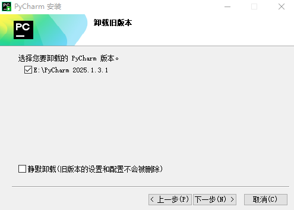
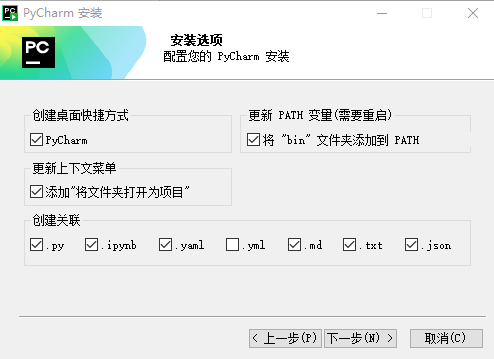
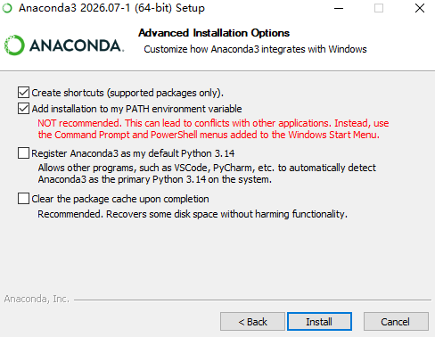
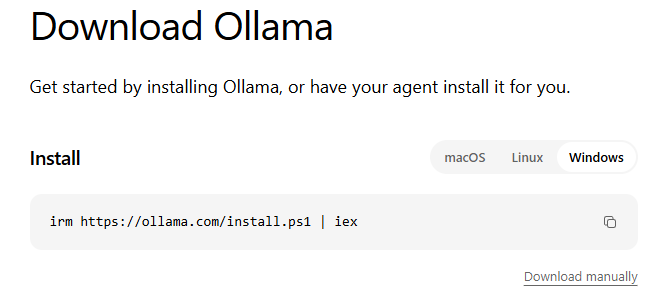

上一篇介绍了医学 AI Agent 的整体技术路线。这一期先从最基础的准备工作开始：把写代码、管理 Python 环境、运行本地大语言模型和部署项目所需的工具配置好。

本文以 **Windows 电脑**为例，主要介绍工具安装与容易踩坑的选项。具体的 Python、PyTorch 和 CUDA 版本，需要结合后续项目的依赖要求确定，留到实际运行与训练环节再展开。

## 一、先明确这几个工具分别做什么

| 工具 | 在项目中的用途 |
| --- | --- |
| PyCharm | 编写、运行和调试 Python 代码 |
| Anaconda | 管理 Python 解释器、依赖包和项目环境 |
| Ollama | 下载、管理和运行受支持的本地大语言模型 |
| Docker Desktop | 运行项目提供的容器，简化部分开源项目的部署 |

这些是我当前技术路线中准备使用的工具，并不意味着所有 Agent 项目都必须采用同一套组合。先理解各自的作用，后面排查问题时也更容易知道该从哪里入手。

安装前还建议提前规划磁盘空间。开发工具、环境和模型可以放在空间充足的 D 盘或 E 盘；尤其是模型文件，下载前最好先确定存储位置，避免不知不觉把系统盘占满。安装路径尽量简洁，便于后续在终端中使用。

## 二、安装 PyCharm

下载入口：[PyCharm Windows 下载页面](https://www.jetbrains.com/pycharm/download/?section=windows)。

PyCharm 是面向 Python 开发的集成开发环境。初次安装可以选择官网提供的稳定版本；如果已有项目明确要求特定版本，则优先遵循项目说明。版本更新后，安装界面可能与本文截图略有不同。

### 1. 升级时保留原有设置

如果电脑已经装过 PyCharm，安装程序可能会提示卸载旧版本。可以按需勾选需要替换的版本，但想保留原来的配置时，**不要选择删除旧版设置和配置的“静默卸载”选项**。



### 2. 按需勾选安装选项

选择安装目录后，重点看下面几个选项：

- **更新 PATH 变量**：将 PyCharm 的 `bin` 目录加入 PATH，便于从终端启动工具。建议勾选，并按安装器提示重启终端或电脑。
- **更新上下文菜单**：在右键菜单中添加“将文件夹打开为项目”，打开本地项目会方便一些。
- **创建关联**：让选定类型的文件默认使用 PyCharm 打开，可根据自己的使用习惯选择。
- **创建桌面快捷方式**：按个人习惯勾选即可。



这里的 PATH 选项只是方便调用 PyCharm，**不等于已经配置好了 Python 解释器和项目依赖**。项目环境还需要在后面的步骤中单独设置。

对于本文涉及的基础 Python 开发，先使用免费功能即可，不必急着购买 Pro。当前统一版 PyCharm 的核心功能免费，部分高级功能需要订阅，具体区别见 [JetBrains 官方说明](https://www.jetbrains.com/help/pycharm/unified-pycharm.html)。如果已经习惯 VS Code，也可以继续使用；我这里选择 PyCharm，是因为它对 Python 项目管理比较直观。

## 三、安装 Anaconda 并管理 Python 环境

下载入口：[Anaconda Distribution](https://www.anaconda.com/download/success?reg=skipped&path=distribution)。

Anaconda 将 Python、Conda 和常见的数据科学工具打包在一起，适合希望先把基础工具装齐的读者。后续不同项目可能需要不同版本的 Python 和依赖包，使用独立环境可以减少相互干扰。

### 1. Anaconda 与 Miniconda 怎么选

本文使用 Anaconda，便于统一后续操作。Miniconda 则是更精简的选择，主要提供 Conda、Python 及基础依赖，其余工具由用户按需安装。它同样可以用于 AI 开发，并不是功能不完整，只是需要自己安装更多软件包。

已经使用 Miniconda 的读者，不必仅为了跟随本文而重新安装 Anaconda。

### 2. 安装目录与 PATH 选项

安装目录可以选择空间充足的非系统盘。到了高级选项界面，尤其要注意 **Add installation to my PATH environment variable**。



**如果电脑之前完全没有安装或配置过 Python、Anaconda 等环境，直接按照图中的选项勾选即可。** 将 Anaconda 加入 PATH 后，便于在终端中调用相关工具；安装完成后，重新打开终端再使用。

如果电脑上已经有其他 Python 或 Conda 环境，则不建议直接照搬 PATH 设置，以免影响已有配置。图中的“注册为默认 Python”保持未勾选，后续在 PyCharm 中单独选择项目需要的解释器即可。

安装完成后，可以在 **Anaconda Prompt** 中检查：

```shell
conda --version
conda env list
```

后续为项目创建独立环境，再让 PyCharm 使用该环境中的 Python 解释器。Python 版本以项目依赖为准，不需要因为安装器附带了较新版本，就让所有项目都使用同一个版本。

### 3. 已有虚拟环境怎么迁移

如果以前已经创建过 Conda 环境，**不要直接复制整个 `envs` 文件夹后就删除旧目录**。环境中的部分文件可能记录了原安装路径，简单移动后不一定还能正常运行。

更稳妥的方式是先导出环境，再在新安装的 Conda 中重建。下面的 `old-env` 和 `medical-agent` 都是示例名称，需要替换成自己的环境名。

在旧环境仍可用时导出：

```shell
conda env export -n old-env > environment.yml
```

检查导出的 `environment.yml`，如果末尾有指向旧位置的 `prefix:`，先移除该行。随后在新安装的 Conda 中重建：

```shell
conda env create -n medical-agent -f environment.yml
conda activate medical-agent
python --version
```

重建后还要验证项目能否运行，并在 PyCharm 中重新选择解释器。确认代码、依赖和数据都能正常使用，再清理旧环境。涉及本地安装包或不同操作系统时，仍可能需要手动调整依赖；更多方式可参考 [Conda 环境管理文档](https://docs.conda.io/projects/conda/en/latest/user-guide/tasks/manage-environments.html)。

## 四、安装 Ollama 并规划模型存储位置

下载入口：[Ollama 官方下载页面](https://ollama.com/download)。

Ollama 用于管理和运行受支持的大语言模型，方便后续在本地测试模型调用。本文将它作为本地推理工具；具体模型能否运行，还要看模型支持情况、内存和显存容量。

### 1. 使用安装包安装

如果暂时不熟悉命令行，可以在下载页面选择 **Windows**，再点击 **Download manually** 下载 Windows 安装包。



### 2. 下载模型前先设置存储目录

相比程序本身，模型文件通常更占空间。因此，安装完成后先确认模型目录，再开始下载模型。

按照 [Ollama 官方 FAQ](https://docs.ollama.com/faq) 的说明，Windows 下可以通过用户环境变量 `OLLAMA_MODELS` 指定模型存储目录，例如：

```text
变量名：OLLAMA_MODELS
变量值：D:\AI\OllamaModels
```

可以在 Windows 中搜索“编辑账户的环境变量”，新建或修改这个用户变量。设置完成后，**完全退出 Ollama，再重新启动**，让新配置生效。如果当前版本的应用也提供模型目录设置，请同时确认界面中的位置与预期一致。

改目录不会自动搬走已经下载的模型。如果之前下载过模型，需要另外处理迁移，并在确认新目录可用后再清理旧文件。

安装后可以重新打开终端，检查程序和本地模型列表：

```shell
ollama --version
ollama list
```

还没有下载模型时，列表为空是正常的。本期先完成工具准备，具体选择哪个模型、怎样调用，后续再结合任务展开。

## 五、安装 Docker Desktop

下载入口：[Docker Desktop](https://www.docker.com/products/docker-desktop/)。

不少 GitHub 开源项目提供了 Docker 部署方式，可以把应用及所需依赖打包运行，减少手动配置的步骤。对于我当前计划采用的项目，Docker 是需要准备的工具；其他技术路线是否需要安装，则以项目自身的部署说明为准。

Docker Desktop 的安装涉及系统虚拟化、WSL 等配置，篇幅比前面几个工具更长，这里先保留教程入口，便于单独跟着操作：

- [原稿中提供的 Docker 安装教程](https://blog.csdn.net/2401_87660168/article/details/158742240)
- [Docker Desktop Windows 官方安装文档](https://docs.docker.com/desktop/setup/install/windows-install/)

安装步骤和系统要求以官方文档为准。安装完成并启动 Docker Desktop 后，可以在终端检查：

```shell
docker --version
docker compose version
docker info
```

前两条用于确认命令行工具可用，`docker info` 则用于检查能否连接到正在运行的 Docker 引擎。如果提示连接失败，先确认 Docker Desktop 是否已经启动完成。

## 六、后续可以了解的微调工具

基础环境准备好之后，还可以逐步了解下面两个项目：

- **[Unsloth](https://github.com/unslothai/unsloth)**：提供模型训练与微调相关工具，可以作为后续学习高效微调的入口。
- **[LLaMA-Factory](https://github.com/hiyouga/LlamaFactory)**：支持多种大语言模型和视觉语言模型的微调，并提供 WebUI，便于通过界面配置训练任务。

对于初学者，可视化界面有助于熟悉操作流程，但仍需要理解数据格式、模型选择、显存要求和训练参数。这两项先作为后续学习方向，不必在本期全部安装完成。

## 七、本期完成清单

开始下一阶段前，可以逐项确认：

- PyCharm 能正常启动，并能打开项目文件夹。
- Anaconda Prompt 中能执行 Conda 命令，了解如何管理独立环境。
- 已有环境的迁移经过验证，未提前删除旧环境。
- Ollama 能正常启动，模型存储位置已经确定。
- Docker Desktop 能启动，终端可以连接 Docker 引擎。

这一期先把开发工具准备好。接下来再根据实际项目确定 Python、PyTorch 与 CUDA 的版本组合，验证 GPU 调用，并逐步进入数据整理和模型运行环节。
