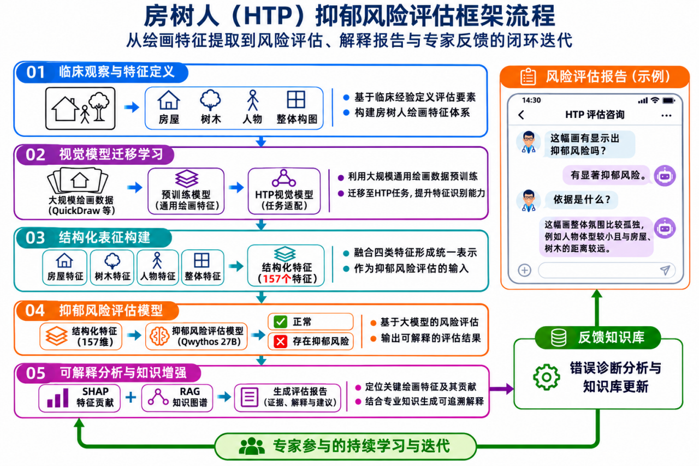

*图 1. HTP-VTDA 框架：临床观察与特征定义、视觉迁移学习、结构化特征构建、风险初判，以及 SHAP 与 RAG 支持的解释和反馈。*

图中将流程分为五个环节：先定义房屋、树木、人物与整体构图的特征体系，再通过通用绘画数据与 HTP 任务数据适配视觉模型；将观察结果统一到包含 157 项预定义特征的表示体系后，交给 Qwythos 27B 进行初步分类。随后结合 SHAP 特征贡献和 RAG 检索知识生成解释报告。157 项指预定义特征体系，并不表示每张绘画都会出现全部特征。

右侧的风险报告是展示示例；下方的专家反馈、错误诊断和知识更新表示系统设计中的迭代闭环，不代表每次反馈都会自动更新模型参数。图中的“正常／存在抑郁风险”对应研究分类及其报告表述，不能仅凭该示例视为已经完成临床验证。

## 一、LLM 是怎样处理一项任务的？

理解大语言模型（LLM），可以先记住一个基本逻辑：**输入数据 + 任务指令 → 模型处理 → 输出结果**。

1. **输入数据：** 可以是文字、图像，或其他模型能够接收的信息。模型先把输入转换成内部表示，供神经网络计算。
2. **任务指令：** 通过提示词（Prompt）告诉模型要完成什么任务、依据什么信息、遵守哪些要求，以及结果需要采用什么格式。
3. **模型处理与生成：** 模型根据输入和指令计算输出。对于生成式模型，结果通常由模型逐个 token 生成；分类任务也可以通过比较候选类别的输出分数，得到分类结果。
4. **结果检查：** 对结构化输出，还需要由程序检查字段、类别、数值范围和格式是否符合要求。

因此，调用模型时，关键是把任务目标、输入信息和输出要求定义清楚。模型负责根据这些信息完成任务，程序负责接收和检查结果。

## 二、先明确任务，再选择合适的模型

选择模型前，先明确三个问题：**输入是什么？需要模型识别或判断什么？最终希望得到什么结果？** 模型选择应围绕任务本身，而不是单纯追求模型规模或复杂程度。

以 HTP 绘画的视觉特征提取为例，任务不只是识别画面中有没有房屋、树木和人物，而是要从风格差异较大的绘画中，提取树干形态、树根表现、树冠结构、物体位置等细粒度特征，并按照统一规范输出。

传统目标检测模型（如 YOLO）通常需要针对目标类别和边界框准备较多人工标注数据。对于 HTP 绘画，一方面，细粒度特征类别多，标注成本较高；另一方面，同一对象或特征可能存在高度抽象、个体差异明显的画法。若训练数据没有覆盖这些变化，模型遇到稍有不同的线条、形态或组合时，可能出现漏检或误检。

因此，本项目选择具备抽象视觉语义理解能力的视觉语言模型，而不是单纯依赖固定目标类别进行检测的模型。

### VLM 和 LLM 分别是什么？

- **VLM（Vision-Language Model，视觉语言模型）：** 能够联合处理图像和文字指令。本项目使用 Qwen3-VL，根据提示词观察 HTP 绘画中的整体构图、房屋、树木和人物特征，并输出结构化结果。
- **LLM（Large Language Model，大语言模型）：** 主要处理文字。本项目将视觉模型提取的结构化特征交给 Qwythos 27B，完成抑郁风险初步分类；后续再结合 SHAP 特征归因和外部检索知识进行复核与解释。

简单来说，VLM 负责理解图像并把观察结果转成结构化文本，文本 LLM 负责基于这些信息完成分类、复核和解释。两者通过结构化文本衔接。

## 三、Instruct、Thinking 与提示词约束

以 Qwen 系列为代表，一些主流大模型家族会提供 **Instruct（指令跟随）**、**Thinking（推理增强）**等不同版本或模式。具体实现因模型而异：有些模型将二者做成不同的模型版本，有些模型则允许在同一模型中切换思考模式。本项目使用的 Qwen3-VL-30B-A3B-Instruct 属于 Instruct 版本；Qwen3-VL 系列另有对应的 Thinking 版本。

| 类型 | 主要特点 | 常见适用任务 |
| --- | --- | --- |
| **Instruct** | 侧重理解并执行明确指令，按要求生成结果 | 信息提取、格式转换、分类、结构化输出 |
| **Thinking** | 侧重多步骤推理，通常会生成额外的中间推理 token，再输出最终答案 | 复杂推理、多条件分析、数学和代码问题 |

这里要区分**模型内部计算**和**显式生成的思考文本**。Instruct 模型并不是不进行计算：图像编码、特征识别、神经网络前向计算和 token 生成都在进行。它与 Thinking 的主要区别，是是否采用专门的推理模式并生成中间思考 token。

Thinking 模式生成的中间推理内容也需要逐 token 解码，因此会增加生成时间和输出 token 消耗。对于只要求识别特征并返回固定 JSON 的任务，这部分额外输出通常不是必要的。

### 为什么视觉特征提取使用 Instruct？

本项目视觉分支的目标是：根据图像中实际可见的内容，从预定义特征词表中选择描述，返回对应类别、边界框和 JSON 结果。任务重点是**观察准确、遵循词表、输出规范**，而不是生成一段长篇推理说明。

因此，视觉特征提取使用 Qwen3-VL-30B-A3B-Instruct，并通过提示词明确：

- **观察对象：** 当前分支只关注整体构图、房屋、树木或人物中的指定对象；
- **特征范围：** 描述必须从预定义特征词表中选择；
- **定位要求：** 对识别到的对象给出边界框；
- **输出格式：** 只返回规定字段组成的 JSON，不添加额外文字。

这属于**提示词引导的结构化特征提取**。提示词负责定义任务和输出要求，程序再对 JSON、字段、词表和坐标范围进行检查。

如果某个复杂任务确实需要使用 Thinking 模型，可以把需要检查的任务阶段写进提示词，让模型按结构给出简要的中间结果。例如：

```text
请按以下阶段完成视觉分析，并按指定字段组织结果：
1. observation：只记录图中直接可见的对象和视觉现象，不作心理解释。
2. feature_matching：将观察到的现象匹配到给定特征词表；没有对应项时标记为 unmatched。
3. bbox_validation：检查每个边界框是否符合坐标范围、左上角与右下角顺序，以及是否覆盖对应对象。
4. final_result：汇总通过检查的特征，输出规定的 JSON。
```

若希望程序检查这些阶段，可以要求模型把它们作为结构化字段返回，例如：

```json
{
  "observation": ["观察到一棵树，树干基本直立"],
  "feature_matching": [{"observation": "树干基本直立", "description": "直立树干"}],
  "bbox_validation": [{"description": "直立树干", "valid": true}],
  "final_result": {
    "objects": [
      {"bbox_2d": [135, 3, 289, 327], "category": "树木", "description": "直立树干"}
    ]
  }
}
```

这里指定的是**可检查的任务阶段和中间结果格式**，不代表提示词能够完全规定模型内部每一步隐含的思考过程。若正式任务只需要最终 JSON，就只要求输出 `final_result`，避免额外生成中间文本。

## 四、从直接调用到微调：让模型适应具体任务

预训练模型已经具备通用的语言或视觉能力。对于常见任务，可以先通过提示词直接调用；当任务具有专门的领域特征、固定词表、标注规范或输出要求时，可以进一步使用任务数据微调模型，使其更适应目标任务。

### 1. SFT：用标准答案训练模型

**SFT（Supervised Fine-Tuning，监督微调）**是使用输入与标准答案组成的样本继续训练模型。模型接收任务输入后生成结果，再根据生成结果与标准答案之间的差异更新可训练参数。

对于视觉特征提取，一条训练样本通常包括：一张 HTP 绘画、要求提取指定对象特征的提示词，以及人工核对后的 JSON 标注。模型学习的是：给定图像和任务指令，如何输出符合标注规范的结果。

### 2. LoRA：更节省资源的微调方式

**LoRA（Low-Rank Adaptation，低秩适配）**是一种参数高效微调方法。它通常冻结原模型的大部分参数，只训练额外加入的低秩参数，从而降低微调所需的显存和计算资源。

两者的关系可以这样记：**SFT 说明训练任务和监督方式，LoRA 说明如何以较少的可训练参数完成适配。** 因此，可以使用 LoRA 来实施 SFT。

在 HTP-VTDA 中，视觉模型通过任务数据适配 HTP 特征提取；风险评估模型则通过 LoRA 适配结构化视觉特征到风险分类的任务。

### 3. 用一条视觉特征样本理解训练数据

实际训练数据通常采用对话格式。下面以树木分支为例，保留一条样本的核心内容；完整特征词表和提示词细节放在视觉特征提取篇说明。

**输入指令（简化版）**

```text
<image>
请提取图中可见的树木特征。
类别固定为“树木”；description 必须从预定义词表中选择；
bbox_2d 使用 [x1, y1, x2, y2] 格式，坐标范围为 0–447。
只返回 objects JSON，不添加其他文字。
```

**对应的标准答案（简化版）**

```json
{
  "objects": [
    {
      "bbox_2d": [135, 3, 289, 327],
      "category": "树木",
      "description": "直立树干"
    },
    {
      "bbox_2d": [135, 3, 288, 327],
      "category": "树木",
      "description": "暴露的树根"
    }
  ]
}
```

在训练数据中，输入图像和指令构成模型的任务输入，人工核对后的 JSON 是模型需要学习生成的目标答案。大量此类样本共同构成监督微调数据。

## 五、SHAP：分析哪些特征推动了分类结果

当一个分类任务需要综合多项特征作出判断时，模型输出的标签往往由多个特征共同影响。只知道模型预测了哪个类别，并不能看出哪些输入特征对这个结果影响较大。**SHAP（SHapley Additive exPlanations）**就是一种用于分析特征贡献的方法。

SHAP 基于博弈论中的 Shapley value 思想，估计某个特征加入不同特征组合后，对模型输出带来的边际变化。当一个分类结果由多项特征共同作用、特征之间可能存在组合影响，而且研究者希望知道各项输入对某个类别输出的贡献方向和大小时，可以使用 SHAP。

SHAP 不只适用于传统机器学习模型。**经过微调、已经具备分类预测能力的 LLM，也可以作为待解释的分类模型进行 SHAP 分析**：把实际使用的 LLM 封装成一个预测函数，输入不同的特征组合，读取模型对目标类别的输出，再由 SHAP 比较加入或移除特征前后的输出变化，估计各特征的贡献度。因此，不必为了做 SHAP 另行训练一个替代分类器，解释对象仍然是实际执行分类的微调 LLM。

需要区分的是，SHAP 可以解释模型函数的输入—输出关系，并不意味着一定要读取模型内部权重或神经元。HTP-VTDA 当前采用的是 **Monte Carlo permutation SHAP**：通过构造不同的特征子集并调用实际分类模型，估计各特征对初步分类输出的边际贡献。

### HTP-VTDA 中怎样使用 SHAP？

本项目将结构化 HTP 描述中的不同特征作为归因单元。对于同一幅绘画，程序构造不同的特征子集，并将这些子集分别输入同一个微调后的风险评估 LLM，观察初步分类结果如何变化。随后使用 Monte Carlo permutation SHAP，对不同特征加入顺序下的边际变化进行平均，得到各项视觉特征的 SHAP 贡献值。

当前实现解释的是**知识复核之前的初步二分类输出**，而不是最终复核标签，也不是经过临床校准的风险概率。

- **SHAP 为正：** 该特征推动模型输出朝“抑郁风险”方向变化。
- **SHAP 为负：** 该特征推动模型输出朝“正常”方向变化。
- **绝对值较大：** 在当前模型、提示词和特征组合设置下，该特征对初步分类结果的影响较大。

SHAP 回答的是：**模型作出这次初步分类时，哪些输入特征对结果影响较大，方向是什么？** 它解释的是模型如何利用输入特征，不代表这些特征与抑郁之间存在因果关系，也不能单独证明某项特征具有特定临床含义。

## 六、RAG 与 LightRAG：调用外部知识辅助复核

**RAG（Retrieval-Augmented Generation，检索增强生成）**的核心是：模型生成回答前，先从外部知识库检索相关资料，再把检索结果作为上下文交给模型参考。

需要特别区分：**RAG 不是微调，而是一种外部知识检索与上下文增强机制。** 在典型 RAG 架构中，检索系统作为模型之外的知识层：收到问题后，先从外部知识库检索相关资料，再把检索结果连同原始问题一起放入 LLM 的输入上下文，由 LLM 参考这些资料生成回答。检索这一步本身不会更新生成模型的参数，因此知识库可以独立维护和更新，不必每次更新资料都重新训练 LLM。

可以把 RAG 理解为给 LLM 接入一个**外部知识库或“外置知识层”**：LLM 负责理解问题、综合材料并生成结果；检索系统负责查找和提供外部资料。不同 RAG 系统的检索算法、知识组织方式和接口实现可以不同，但“先检索、再把相关内容交给生成模型使用”是其基本思路。

### RAG 中常见的几个概念

- **Embedding（嵌入）：** 将文本转换成向量表示，用于计算语义相似度。
- **向量检索：** 根据查询内容，从知识库中找出语义上相关的文本片段。
- **知识图谱：** 用实体及实体之间的关系组织知识，便于查找概念及其联系。
- **Chunk（文本块）：** 将较长资料切分成适合检索的片段，并保留来源信息。

**LightRAG**在文本片段检索之外，利用实体和关系组织知识检索结果。本项目由 Python 程序根据当前绘画的结构化特征构造查询，调用 LightRAG 检索相关实体、关系和原文片段，再将检索结果与初步分类、SHAP 贡献及相关规则一起交给 LLM 进行复核和解释。

可以把 SHAP 和 RAG 理解为两种不同的信息来源：

| 方法 | 提供什么信息 | 在本项目中的作用 |
| --- | --- | --- |
| **SHAP** | 模型输出对各输入特征的归因结果 | 分析哪些视觉特征推动了初步分类，帮助确定复核重点 |
| **RAG** | 外部知识库中的资料、关系和原文来源 | 为特征解释和风险复核提供外部参考依据 |

SHAP 解释模型为什么这样预测；RAG 检索外部资料，供模型判断这些解释是否有知识依据。最终由 LLM 综合初步分类、特征贡献和检索证据，完成二次复核与解释。

## 参考资料

1. [Qwen3-VL-30B-A3B-Instruct 模型卡](https://huggingface.co/Qwen/Qwen3-VL-30B-A3B-Instruct)
2. [Qwen3-VL-30B-A3B-Thinking 模型卡](https://huggingface.co/Qwen/Qwen3-VL-30B-A3B-Thinking)
3. [SHAP：Permutation Explainer 文档](https://shap.readthedocs.io/en/latest/example_notebooks/api_examples/explainers/Permutation.html)
4. [Lewis et al. Retrieval-Augmented Generation for Knowledge-Intensive NLP Tasks. NeurIPS 2020](https://proceedings.neurips.cc/paper/2020/hash/6b493230205f780e1bc26945df7481e5-Abstract.html)
